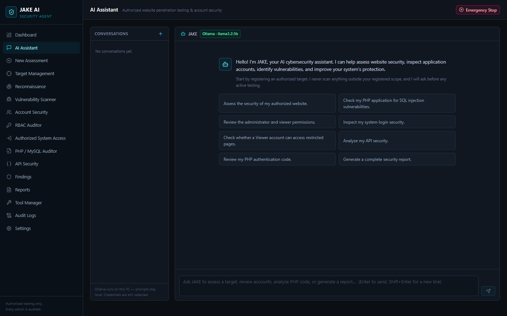

## JAKE AI — desktop cybersecurity agent

**JAKE AI** is the Electron app in [`desktop/jake-ai`](desktop/jake-ai/README.md), separate from the offline assistant documented below. It pairs a free local AI agent (Ollama/Qwen by default, or any OpenAI-compatible provider) with authorized reconnaissance, safe OWASP checks, account/RBAC/API/PHP/MySQL audits, reports and an audit log.

[Download for Windows](https://github.com/itsupportgoc-alt/jake-ai/releases/download/v1.1.0/JAKE-AI-Setup-1.1.0.exe) · [Full documentation](desktop/jake-ai/README.md) · [Releases](https://github.com/itsupportgoc-alt/jake-ai/releases)



**Using the AI:** install and open the app → **Settings → AI provider** to choose Ollama or another provider and run **Test connection** → register the authorized site in **Target Management** → open **AI Assistant** and ask it to run reconnaissance and the safe vulnerability scan → review the findings and generate a report. The assistant can only call JAKE's fixed tools; active tests require approval, scope is enforced, and destructive actions are unavailable. With Ollama, prompts stay on the PC.

> The repository is private, so the download link requires GitHub access. The build is unsigned; Windows SmartScreen may warn.

---

# Jake

An autonomous personal AI assistant for Windows (extensible to Linux/macOS) with a
native Android companion. Not a chatbot wrapper, not a WebView — a real agent:
the AI brain *proposes*, the permission-controlled Rust tool system *disposes*.

```
you → chat/voice → Jake BRAIN (Python: providers, planning, memory)
                        │ JSON-RPC 2.0 over stdio
                        ▼
               Jake core (Rust: event bus → agent loop → permission gate → tools)
                        │
               apps · files · input · screen · Android gateway
```

> Status legend used throughout the docs: **IMPLEMENTED**, **PARTIALLY IMPLEMENTED**,
> **NOT IMPLEMENTED**. Nothing is claimed as working until a test exercises it.

## Current status — Phases 1–3 (core): see table

| Capability | Status |
|---|---|
| Rust agent runtime: event bus, budgets, timeouts, cancellation, emergency stop | IMPLEMENTED |
| Permission model: levels 0–4 × autonomy 1–5, confirmation flow, trusted rules | IMPLEMENTED |
| Tool registry + JSON-Schema validation + timeouts + path sandbox | IMPLEMENTED |
| Tools: `time.now` `sys.info` `fs.list` `fs.read` `fs.search` `fs.create` `fs.copy` `fs.move` `fs.delete` `app.list` `app.open` `app.close` `screenshot` | IMPLEMENTED |
| Python brain over supervised JSON-RPC stdio (restart, honest failure) | IMPLEMENTED |
| `LLMProvider` abstraction + OpenAI-compatible adapter + offline test provider | IMPLEMENTED |
| Secret redaction (logs + cloud egress) and structured rotating logs | IMPLEMENTED |
| `jake` chat / doctor / tools / config / speak / listen CLI | IMPLEMENTED |
| Conversation memory (short-term in-session) | IMPLEMENTED |
| Voice **output** (TTS: `jake speak`, WAV-render verification) | IMPLEMENTED |
| Voice **input** (STT: `jake listen`) | PARTIALLY IMPLEMENTED — engine runs; this machine reports “no audio device” honestly |
| Screen capture (`screenshot`, PNG-verified, blocked in Privacy Mode) | PARTIALLY IMPLEMENTED — verified to fail honestly in this headless session; needs an interactive desktop to actually capture |
| Wake word · VAD · mic loop · voice conversation | NOT IMPLEMENTED (needs an audio capture stack) |
| Keyboard/mouse injection · OCR · UI-tree automation | NOT IMPLEMENTED (Phase 3 continuation) |
| Persistent memory · automations · Android · cross-device · desktop UI · installer | NOT IMPLEMENTED (Phases 4–8, see `docs/roadmap.md`) |

## Prerequisites

- Windows 10/11 (developed and tested on Windows 11, x86_64)
- Rust (stable, `x86_64-pc-windows-gnu` toolchain) + a MinGW-w64 toolchain
  (`gcc`, `dlltool`) on `PATH` — e.g. WinLibs via `winget install BrechtSanders.WinLibs.POSIX.UCRT`
- Python 3.11+ (developed on 3.15) — `python` on `PATH`
- Optional: an OpenAI-compatible API key (OpenAI, OpenRouter, LM Studio, Ollama…)

## Quickstart

```bash
# 0) toolchain paths for this machine (MinGW + venv)
source scripts/env.sh

# 1) build
cargo build --release

# 2) offline check — no API key needed
python -m venv .venv
```

## Useful commands

```text
jake chat [--once "..."] [--yes]   interactive assistant (Ctrl+C = emergency stop)
jake doctor                        configuration / brain / provider health checks
jake tools [--json]                registered tools with permission levels
jake config                        effective configuration (secrets redacted)
```

In-chat: `/help`, `/tools`, `/autonomy 1..5`, `/reset`, `/stop`, `/quit`.

Voice:

```bash
jake speak "System status nominal"              # speak through the Windows TTS
jake speak --wav out.wav "rendered check"       # offline-verifiable render
jake listen --seconds 8                         # one dictation pass (needs a mic)
```

## Configuration

Copy `config/jake.example.toml` to `config/jake.toml` and edit. Every value has
an environment override: `Jake_<SECTION>_<KEY>` (e.g. `Jake_AGENT_MAX_STEPS=4`).
API keys are **never** stored in files — use `Jake_LLM_API_KEY`. See
`docs/permissions.md` and `docs/security.md` for the safety model.

## Development

```bash
source scripts/env.sh
cargo test --workspace                        # 113 Rust tests incl. 11 real e2e
PYTHONPATH=core/python .venv/Scripts/python.exe -m pytest core/python/tests  # 51 Python tests
```

## Documentation

`docs/architecture.md` · `docs/technology.md` · `docs/security.md` ·
`docs/permissions.md` · `docs/roadmap.md` · `docs/phase1.md` · `docs/structure.md` ·
`docs/environment.md` · `docs/repository-analysis.md` · `docs/dependencies.md`
