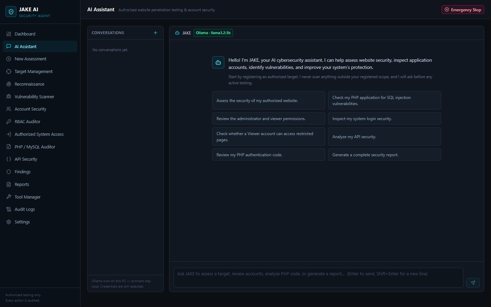
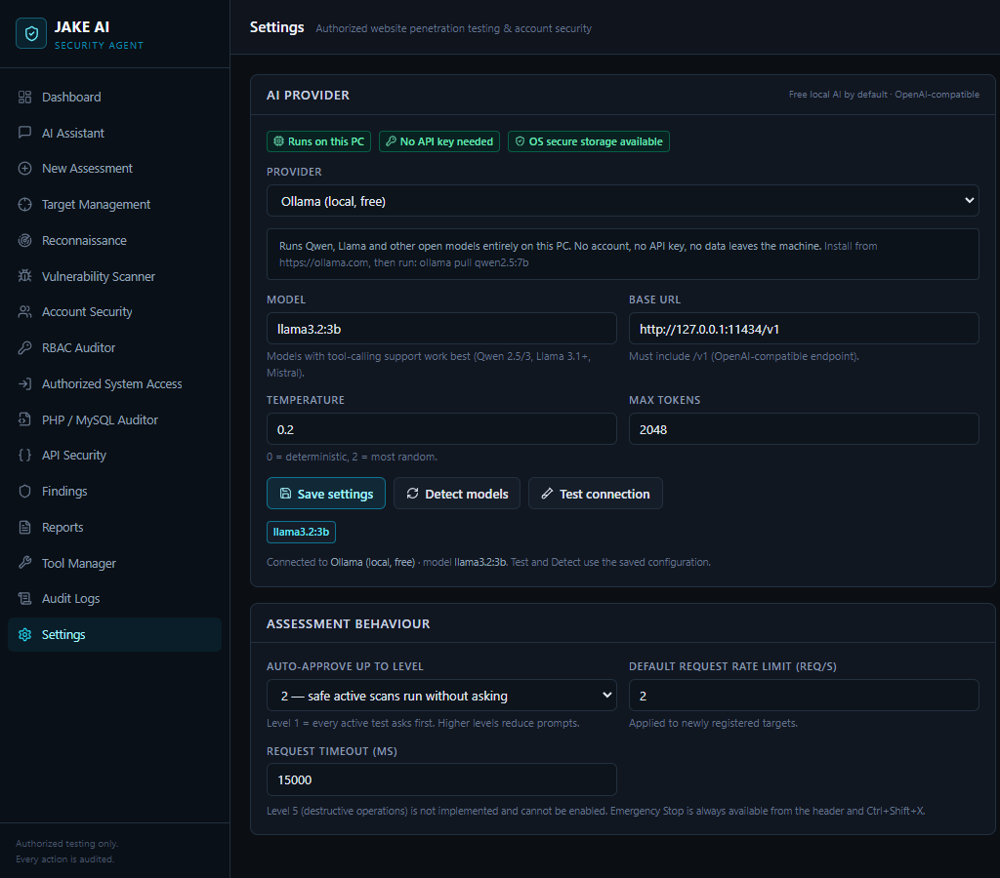

# JAKE AI

**Advanced AI cybersecurity, website penetration testing & system account security agent.**

JAKE AI is an Electron desktop application for **authorized** security assessment. It combines a provider-agnostic AI agent — running free and local through Ollama/Qwen by default — with deterministic security modules: passive reconnaissance, safe OWASP-aligned web checks, account security auditing, RBAC boundary testing, authorized browser access, PHP/MySQL review, API assessment, reporting and a full audit trail.

> JAKE AI is for systems you own or have explicit written permission to test. The application enforces a registered target scope, rate limits and approval checkpoints. It is not an exploitation framework and contains no destructive features.

## Download

[**Download JAKE AI 1.1.0 for Windows**](https://github.com/itsupportgoc-alt/jake-ai/releases/download/v1.1.0/JAKE-AI-Setup-1.1.0.exe) — NSIS installer, 93 MB.

Run the installer, then configure an AI provider (Ollama is the default and needs no key).
The build is unsigned, so Windows SmartScreen may show a warning. While this repository is
private, the download link requires a GitHub account with access.

## UI

The app uses a fixed 16-screen navigation rail. The **AI Assistant** is the primary workspace; **Settings** controls the model and provider.

### AI Assistant



- Conversation list with new/delete controls.
- Active provider and model badge, so the operator always knows where prompts go.
- Streaming answers, inline tool-call output and a Stop button.
- Suggested tasks and an always-visible Emergency Stop.
- Approval modals for active testing; every action is written to the audit log.

### AI provider settings



- Local Ollama/LM Studio by default, or Qwen, OpenRouter, Groq, OpenAI or a custom OpenAI-compatible endpoint.
- Model, base URL, temperature and token limit.
- **Detect models** lists what is installed; **Test connection** performs a live probe and reports latency.
- Local-vs-cloud privacy notice and per-provider encrypted key storage.

## What is actually implemented

| Area | Status | Notes |
|---|---|---|
| Electron shell + React/TypeScript/Tailwind UI | Implemented | Context isolation, sandbox, no Node in renderer, strict CSP, allowlisted IPC |
| AI agent: Ollama + Qwen by default, plus any OpenAI-compatible API | Implemented | Streaming, tool calling, provider presets, model detection, connection test, per-provider keys in OS `safeStorage`; temperature/token settings |
| Agent engine (plan → tools → approvals → report) | Implemented | 6-step tool loop, conversation memory, cancellation, audit |
| SQLite persistence | Implemented | Real SQLite (sql.js/WASM), migrations, FKs, transactions, atomic saves |
| Target authorization & scope manager | Implemented | Allowlists, DNS resolution, private-range blocking, redirect checks, rate limits |
| Passive reconnaissance | Implemented | DNS, TLS, headers, tech fingerprint, robots, sitemap, links, crt.sh subdomains, SPF/DMARC |
| Safe web vulnerability assessment | Implemented | Headers, cookies, HTTPS, sensitive paths, admin interfaces, CORS, CSRF forms, reflection/SQL-error probes, methods |
| Account Security Auditor | Implemented | Generic admin-API mapping; dormant/duplicate/privileged/MFA/policy/failed-login analysis |
| RBAC auditor | Implemented | Unauthenticated vs Viewer vs Admin on safe (GET/HEAD/OPTIONS) routes |
| Authorized system access | Implemented | Headed system Edge/Chrome via playwright-core; manual login; structure capture with password values stripped |
| PHP security auditor | Implemented | 11 rule families, read-only, Monaco viewer, approval-gated patches with backups |
| MySQL / MariaDB auditor | Implemented | Read-only session; grants, hash-prefix algorithm, schema/FK/PK, server hardening |
| API security assessment | Implemented | Auth, data exposure, CORS, cache, methods, docs, rate-limit sampling |
| Reports | Implemented | HTML + JSON + PDF (Chromium `printToPDF`); secrets redacted |
| Audit log, approvals, emergency stop | Implemented | DB-backed; Ctrl+Shift+X |
| External tools (Nmap/Nikto/ZAP) | Implemented when installed | Detection + fixed argument builders + WSL routing + timeouts |
| WSL / Ubuntu integration | Implemented | Detection, distro list, tool probing, template commands |
| Windows installer | Configured | `npm run dist` (NSIS), see below |
| Voice, mobile, cloud sync | Not implemented | Not part of this application |

No feature is represented as working unless the corresponding module performs a real operation. There is no demo data, no fake findings and no simulated scan results.

## Requirements

- Windows 10/11 (64-bit). Ubuntu 24.04 under WSL2 is optional for Linux-only tools.
- Node.js 20+ (tested with Node 24).
- Microsoft Edge or Google Chrome for authorized browser sessions.
- Optional: Nmap, Nikto, OWASP ZAP, MySQL/MariaDB (XAMPP), Ollama or another OpenAI-compatible AI endpoint. No paid API key is required for the local Ollama path.

## Install and run

```bash
cd desktop/jake-ai
npm install
# npm 11 blocks dependency install scripts; allow the Electron/esbuild binaries:
node node_modules/esbuild/install.js
node node_modules/electron/install.js

npm run build     # builds dist/ (renderer) + dist-electron/ (main, preload)
npm start         # launches JAKE AI
```

Development with hot reload:

```bash
npm run dev
```

Checks:

```bash
npm run typecheck
npm test
```

Installer:

```bash
npm run dist      # writes release/JAKE-AI-Setup-1.1.0.exe (NSIS)
```

## Configure a free AI provider

JAKE speaks the OpenAI-compatible API. Local and free options are first-class; no paid account is required.

### Ollama — default, fully local and free

1. Install Ollama from https://ollama.com.
2. Pull a tool-capable model: `ollama pull qwen2.5:7b` (or `ollama pull llama3.2:3b` for a low-RAM machine).
3. Open **Settings → AI provider**. Provider `Ollama (local, free)`, base URL `http://127.0.0.1:11434/v1`, model `qwen2.5:7b` (or the model you pulled).
4. Click **Detect models** to confirm what is installed, then **Test connection**. A successful test shows the model's reply and latency.

If the saved model is not installed, JAKE automatically selects an installed model (preferring Qwen, then Llama), saves that choice and reports it in the connection test. You can still pick a different model explicitly.

Prompts, tool summaries and replies are processed on this PC and are not sent to any cloud service.

### Qwen / DashScope

Choose **Qwen / DashScope**, keep the preset base URL, add a key from the Alibaba Cloud Model Studio console, and use `qwen-plus` or another Qwen model. DashScope includes a free trial quota, after which it is paid.

### OpenRouter free models

Choose **OpenRouter (free models)** and use a model whose id ends in `:free` (the preset default is `qwen/qwen-2.5-72b-instruct:free`). Free models are rate-limited and their availability changes; check OpenRouter's model list.

### Groq, LM Studio, custom endpoints

- **Groq** has a free tier and very fast Qwen/Llama inference; add a key from its console.
- **LM Studio** runs a local OpenAI-compatible server on port 1234; no key is needed.
- **Custom** accepts any server exposing `/v1/chat/completions` (vLLM, llama.cpp, LocalAI, a gateway). Set the base URL including `/v1` and the model name.

### Keys and cloud privacy

Cloud provider keys are stored per provider with Electron `safeStorage` (Windows DPAPI) and only read in the main process. They are never sent to the React renderer, written to logs, or included in reports. When you select a cloud provider, chat messages, system context (target names/IDs, connection names, finding counts) and redacted tool summaries are sent to that provider — **do not send confidential production data without appropriate authorization**. Password, token, cookie and hash values are redacted before transmission. Local providers keep all of this on the machine.

## Using the AI

The assistant is an agent, not a chat wrapper. It can only act through JAKE's registered tools, and every call passes through scope checks, approvals, rate limits and audit logging.

### 1. Register the target first

Open **Target Management** and add the site or API you are authorized to test: URL, authorization basis, optional extra scope hosts, rate limit, and private-network permission for local/staging systems. The AI cannot scan a host that is not registered and in scope.

### 2. Ask for the work

Open **AI Assistant**, describe the authorized goal, and include the target name or ID when more than one exists. Examples:

- “Run reconnaissance and the safe vulnerability scan on my authorized site `Acme Portal`, then summarize the findings.”
- “Audit the accounts exposed by the admin API connection `Acme Admin API`.”
- “Check whether a Viewer account can reach admin routes on `Acme Admin API`.”
- “Review the PHP files in `C:\sites\acme` for SQL injection and weak password hashing.”
- “Generate an HTML report for assessment `<id>`.”

### 3. Review what it does

The agent can call `list_targets`, `start_recon`, `start_vulnerability_scan`, `audit_accounts`, `audit_rbac`, `scan_api`, `audit_php`, `audit_mysql`, `list_findings`, `run_external_tool`, `generate_report` and the authorized-login tool. Active tests ask for approval unless the configured auto-approval level allows them. Tool output appears inline; **Stop** cancels the current reply and **Emergency Stop** cancels every operation.

### 4. Read the evidence

Findings, reports and audit logs are stored locally. The AI summarizes tool results but cannot create findings, CVEs or evidence; the authoritative record is **Findings** / **Reports**. Absence of findings is not proof that a system is secure.

The AI will not scan unregistered hosts, run shell commands or generated code, brute force, exploit, use denial-of-service, modify production accounts, or receive passwords, hashes, tokens or cookies. Level-5 destructive actions are deliberately unavailable.

## Authorization workflow

1. **Target Management** — register name, URL, kind, authorization basis, optional extra scope hosts, rate limit, and private-network permission for local/staging systems.
2. **Reconnaissance** (level 1) — passive only. No approval prompt.
3. **Vulnerability Scanner** (level 2) — approval prompt, safe non-destructive requests.
4. **Account Security / RBAC / API / MySQL** (level 3) — require a connection profile and dedicated credentials.
5. **PHP patches / administrative changes** (level 4) — per-change approval, timestamped backup.
6. **Level 5** — destructive operations are deliberately not implemented.

Every request passes through the scope manager: host allowlist, DNS/IP checks, private-range block unless explicitly allowed, redirect re-validation, per-target rate limiting and timeouts. The AI cannot run arbitrary shell commands; external tools accept only fixed, validated arguments.

### Connection profiles

Account, RBAC, API and MySQL modules use a **connection profile** bound to a registered target:

- REST profile: base URL, admin credential (Bearer/Basic/Cookie), optional Viewer test credential, users/policy/login-events paths, and the routes to test as JSON.
- MySQL profile: host, port, user, password, database (read-only session enforced).

Credentials are encrypted with OS secure storage. When editing a profile, leave secret fields blank to keep the stored value. The UI only receives non-secret configuration.

## Reports

`Reports` exports HTML, JSON or PDF for any assessment. A report contains the executive summary, target information, authorization scope, methodology, findings with evidence, account and permission analysis, human approvals, remediation, limitations and timestamps. Passwords, hashes, keys, cookies and tokens are never included.

Reports are written to Electron's `userData/reports` directory (shown in Settings).

## Project layout

```
desktop/jake-ai/
  electron/
    main.ts                 Electron window, CSP, session hardening, menu
    preload.ts              Minimal allowlisted IPC bridge
    ipc.ts                  Typed IPC handlers + sender validation
    services/
      db.ts                 SQLite (sql.js), schema/migrations, transactions
      store.ts              Settings + OS-encrypted secrets
      audit.ts              Audit log + approval manager
      assessments.ts        Assessment/finding persistence and stats
      scope.ts              Scope enforcement, TLS info, rate limiting, HTTP client
      recon.ts              Passive reconnaissance + header/cookie analysis
      vuln.ts               Safe OWASP-aligned web checks
      rest.ts               Authorized REST requests + JSON mapping helpers
      connections.ts        Encrypted connection profiles
      accounts.ts           Account Security Auditor
      rbac.ts               Access-control boundary testing
      apiScan.ts            API security assessment
      php.ts                PHP static analysis rules
      mysql.ts              Read-only MySQL/MariaDB audit
      tools.ts              Tool detection + fixed-argument execution + WSL
      reports.ts            HTML/JSON/PDF reports
      ai.ts                 Provider-agnostic streaming client + tool calling
  shared/providers.ts       Free/local and cloud provider presets
      agent.ts              Agent loop, tool registry, approvals
      access.ts             Headed browser session + page capture
      context.ts            Service container and guarded operations
  shared/                   Types + IPC allowlist shared with renderer
  src/                      React UI (16 screens)
  tests/                    Unit + integration tests
  scripts/                  esbuild/Vite build and dev orchestration
```

## Security architecture

- `contextIsolation: true`, `sandbox: true`, `nodeIntegration: false`, `webSecurity: true`.
- Renderer cannot access the filesystem, database, secrets or Node APIs.
- Strict CSP in production; navigation and window creation blocked; permissions denied.
- IPC channels are allowlisted in preload and validated in the main process, including sender-frame checks.
- Secrets: `safeStorage`; redaction of Authorization headers, cookies, keys, hashes and password fields before logging or AI transmission.
- Scope enforcement is centralised in `scopedFetch`; redirects are re-validated on every hop.
- External tools: fixed argument builders, target validation, timeout, output cap, audit entries.
- Emergency stop aborts every scan, denies pending approvals, closes the browser session and stops AI streaming.

## Tests

```bash
npm test
```

Covered: redaction, host/private-IP scope rules, redirect escape prevention against a live local HTTP server, PHP rule detection with false-positive check for prepared statements, SQLite schema/foreign-key/transaction behaviour, and provider presets (Ollama default, key requirements, fallback handling).

End-to-end smoke test (starts an isolated local target, drives the real Electron app over CDP in a temporary data directory, then verifies findings and HTML/JSON/PDF output):

```bash
npm run build
npm run test:e2e
```

## Limitations

- Black-box checks cannot prove the absence of vulnerabilities; authenticated business-logic flaws need manual review.
- RBAC testing only sends GET/HEAD/OPTIONS; write authorization must be verified on staging with disposable records.
- Account auditing supports the common REST shapes and JSON paths; unusual APIs may need mapping adjustments.
- PHP analysis is heuristic static analysis, not a full AST/data-flow engine.
- The rate-limit sample is short and may report false negatives behind a WAF/CDN.
- External tool coverage depends on what is installed; JAKE detects rather than assumes.
- Tool calling quality depends on the model. Qwen 2.5/3 and Llama 3.1+ are recommended; very small models may narrate instead of calling tools. The agent never executes free-form commands, so a weak model can only produce a poor plan, not an unsafe action.
- The local Ollama path is exercised by the smoke test when Ollama is running, including a real streamed completion. Cloud providers require your own key; without one, only key handling and error paths are verified.
